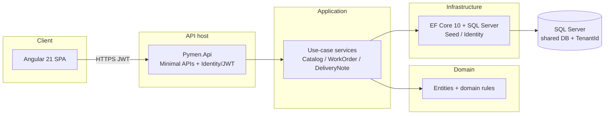
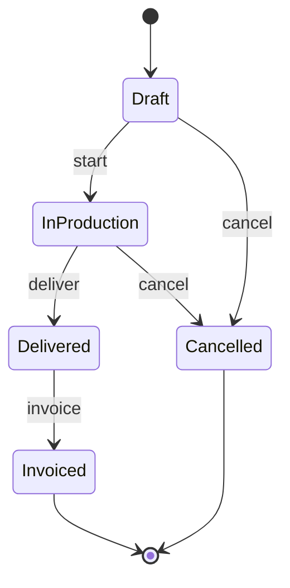
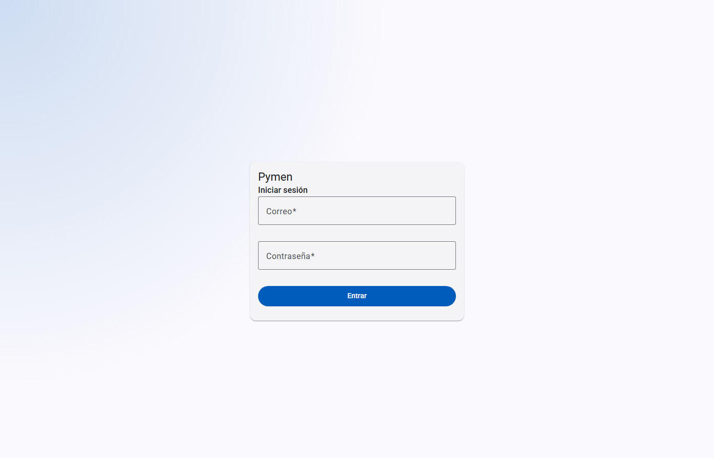
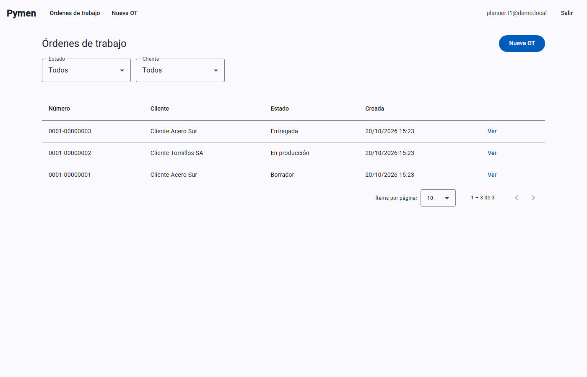
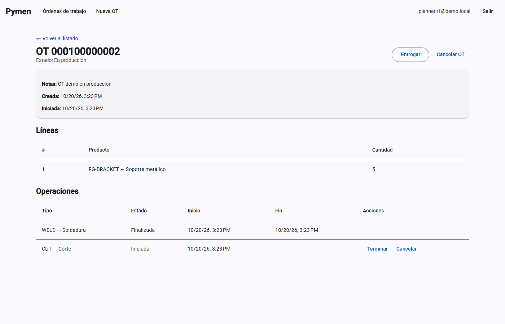

# Pymen Modernization

[](https://github.com/rambmario/pymen-modernization/actions/workflows/ci.yml)
[](https://dotnet.microsoft.com/)
[](https://angular.dev/)
[](LICENSE)

Modernization of a 20-year-old VB.NET WinForms ERP for manufacturing SMEs into a multi-tenant .NET 10 + Angular platform.

---

## Context

Pymen is a manufacturing ERP I designed and maintained for ~10 years as founder of Ingesoft, used in production by SMEs. It was built as a **VB.NET WinForms** desktop app on **.NET Framework 3.5**, with **SQL Server**, **Crystal Reports**, roughly **312k LOC**, **~876 forms**, and **~1,400 stored procedures**. The legacy system is treated as **read-only** analysis input; this repository holds only the greenfield stack.

The goal is not a big-bang rewrite. The project follows a **[strangler fig](docs/adr/0001-estrategia-de-modernizacion.md)** strategy: ship a clean vertical slice (auth, tenancy, work orders) that can grow module by module while the legacy system keeps running. Client names, tax IDs, and production credentials never enter this repo.

---

## What it does

Phase 1 delivers the **production work-order (OT)** core:

- **Work-order lifecycle:** Draft → InProduction → Delivered → Invoiced (plus Cancel from Draft/InProduction).
- **Shop-floor operations** on each OT: start, finish, cancel (role-aware).
- **BOM / recipes** and **stock** modeled in the domain (consumption rules ready for Phase 2 wiring).
- **Delivery notes (remitos)** as first-class aggregates linked to work orders.
- Multi-tenant **Admin / Planner / Operator** roles with JWT auth and a Spanish Angular UI for login, OT list (server-side filters/pagination), detail, and create.

---

## Architecture





Clean Architecture layout: `Domain` ← `Application` ← `Infrastructure` / `Api`, plus `web/` for the SPA. See [ADR 0003](docs/adr/0003-estructura-de-solucion.md).

---

## Key technical decisions

- **Shared-database multi-tenancy** with `TenantId` and **fail-closed** query filters (no ambient tenant → empty results) — [ADR 0002](docs/adr/0002-multi-tenant-base-compartida.md), [ADR 0004](docs/adr/0004-aislamiento-tenants-fail-closed.md).
- **Work-order numbering concurrency** via `Tenant.RowVersion` + allocator retries — [ADR 0005](docs/adr/0005-persistencia-ef-core-sql-server.md).
- **ASP.NET Identity + JWT**, roles Admin/Planner/Operator, `FallbackPolicy = RequireAuthenticatedUser`, login rate limit — [ADR 0006](docs/adr/0006-auth-identity-jwt-roles.md).
- **Application depends on EF Core** (`IPymenDbContext` exposes `DbSet`); no generic repositories (EF already is UoW + Repository) — trade-off in [ADR 0006](docs/adr/0006-auth-identity-jwt-roles.md).
- **`TimeProvider`** for timestamps; **UUID v7** for new ids.
- **Server-side OT pagination/filters** (`items`, `page`, `pageSize`, `totalCount`; max page size 100).
- **Angular SPA** with Material, signals, lazy routes, role guards — [ADR 0007](docs/adr/0007-frontend-angular.md).
- **GitHub Actions CI** + Dependabot; ephemeral JWT/SQL passwords in CI — [ADR 0008](docs/adr/0008-ci-github-actions.md).

---

## Tech stack

| Layer | Choice |
|--------|--------|
| API | .NET 10, Minimal APIs, ASP.NET Identity, JWT |
| Application | Use-case services (no MediatR), FluentValidation |
| Domain | Rich entities, `DomainException`, `TimeProvider` |
| Persistence | EF Core 10, SQL Server, Testcontainers |
| Frontend | Angular 21, standalone, signals, Angular Material |
| Authz | Roles Admin / Planner / Operator; FallbackPolicy |
| Docs / CI | ADRs, worklog, GitHub Actions, Dependabot |
| Package mgmt | Central Package Management (`Directory.Packages.props`) |

---

## Getting started

**Requirements:** .NET SDK 10 (see `global.json`), Node.js 22+, Docker Desktop (**Linux containers**), Git.

```bash
# 1. Secrets / local config (never commit .env)
cp .env.example .env
# Edit MSSQL_SA_PASSWORD, JWT_SIGNING_KEY (≥32 chars), DEMO_PASSWORD_*

# 2a. Full local stack (SQL, API, worker placeholder, SPA+nginx, Azurite, Service Bus emulator)
docker compose up -d --build
# SPA  →  http://localhost:8088   (nginx proxies /api; 8080 often blocked on Windows)
# API  →  http://localhost:5207

# 2b. Or SQL only + run API/SPA on the host
docker compose up -d sqlserver
dotnet run --project src/Pymen.Api --launch-profile http   # http://localhost:5207
cd web && npm ci && npm start                              # http://localhost:4200 (proxies /api)

# 3. Optional — regenerate README screenshots (API + SPA must be running)
cd web && npm run screenshots
```

Docker SQL is published on host port **14333** (avoids clashing with a local SQL Server on 1433). Worker is a host placeholder until Phase 2 / Paso 3 (queue consumer + PDF).

**Demo users** (passwords come from `.env` / `DEMO_PASSWORD_*` — not listed here):

| Email | Role | Tenant |
|--------|------|--------|
| `admin.t1@demo.local` | Admin | Demo tenant 1 |
| `planner.t1@demo.local` | Planner | Demo tenant 1 |
| `operator.t1@demo.local` | Operator | Demo tenant 1 |
| `*.t2@demo.local` | same roles | Demo tenant 2 |

Operator can list/get work orders and drive shop-floor operations only. Admin/Planner manage catalog, OT lifecycle, and delivery notes.

---

## Testing

| Project | Tests | Notes |
|---------|-----------------|--------|
| `Pymen.Domain.Tests` | 30 | Pure domain unit tests |
| `Pymen.Application.Tests` | 7 | Services + InMemory EF |
| `Pymen.Api.IntegrationTests` | 13 | Testcontainers SQL Server (needs Docker) |
| `web` (Vitest) | 11 | Auth, guards, interceptor, OT list |

```bash
# Backend (integration tests start SQL Server via Testcontainers)
dotnet test Pymen.sln

# Frontend
cd web && npm test
```

CI runs both jobs on every push/PR to `main`: [workflow](https://github.com/rambmario/pymen-modernization/actions/workflows/ci.yml).

---

## Screenshots

Captured against the local Dev stack (`docker compose up -d`, API + SPA). Regenerate with `cd web && npm run screenshots` (reads `DEMO_PASSWORD_PLANNER` from `.env`; never hardcodes secrets).

| Screen | Image |
|--------|--------|
| Login |  |
| Work-order list |  |
| Work-order detail |  |

---

## AI-assisted development

This portfolio was built with **Cursor** under project rules (`.cursor/rules`, `AGENTS.md`): Spanish process docs, English code/commits, no PII, legacy tree read-only. Every session is logged in [`docs/worklog.md`](docs/worklog.md) and [`docs/ai-usage.md`](docs/ai-usage.md); architectural choices land as ADRs under [`docs/adr/`](docs/adr/).

---

## Roadmap

| Phase | Focus |
|-------|--------|
| **1** (done) | Foundation: Clean Architecture, EF Core, tenancy, Identity/JWT, Angular OT UI, CI |
| **2** | Azure Service Bus (async stock/PDF jobs), QuestPDF for OT report, Azure deploy |
| **3** | Commercial basics (extended delivery/invoice views, pricing, pending-delivery queries) |

---

## Author

**Mario Ramb** — Senior .NET Full Stack Developer

- LinkedIn: [linkedin.com/in/marioramb](https://www.linkedin.com/in/marioramb)
- GitHub: [github.com/rambmario](https://github.com/rambmario)

---

## License

[MIT](LICENSE)
