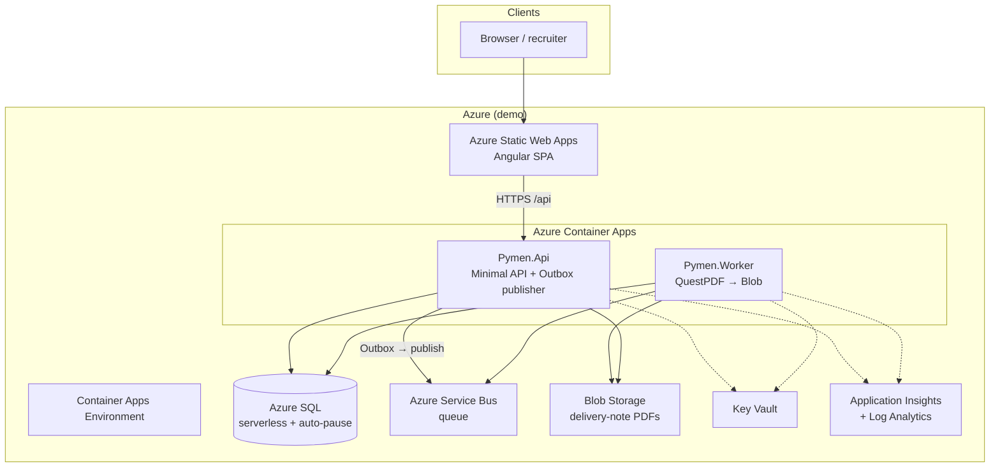
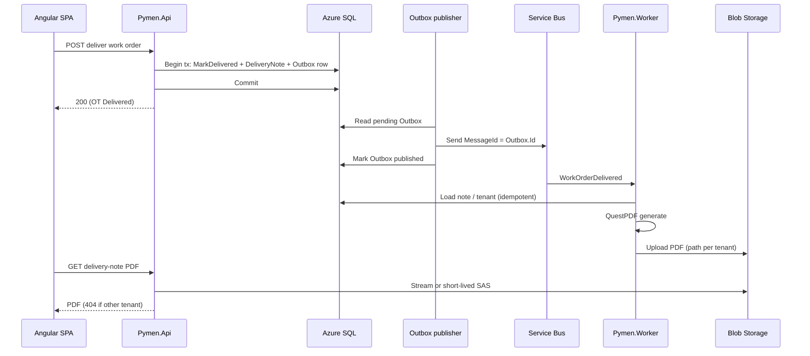

# Arquitectura cloud objetivo (Fase 2)

Diagrama de la arquitectura acordada en [ADR 0009](adr/0009-arquitectura-cloud-azure.md) y mensajería [ADR 0010](adr/0010-mensajeria-async-outbox.md).

## Vista lógica

## Flujo: entrega de OT → PDF de remito

## Principios

- **Sin secretos en repo:** Managed Identity + OIDC en CI; Key Vault solo si hace falta.
- **Multi-tenant:** filtros `TenantId` en API y rutas de blob por tenant.
- **Costo mínimo:** scale-to-zero, SQL auto-pause, Static Web Apps Free, grants de consumo.
- **Observabilidad:** OpenTelemetry → Application Insights con `TenantId` (sin PII).
