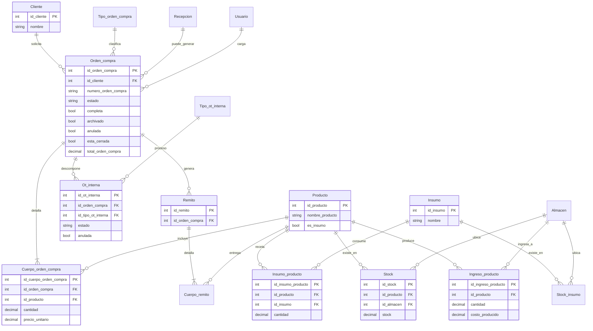

# Análisis del sistema legacy Pymen

**Fecha:** 2026-10-19  
**Alcance:** Fase 0 — solo lectura del código en `D:\VBNetAnterior\Pymen`  
**Nota de privacidad:** nombres reales de empresas, clientes, IPs y credenciales se reemplazan por genéricos.

---

## a. Resumen ejecutivo

**Pymen** (ensamblado publicado como *Gestion Administrativa*) es un ERP de escritorio orientado a **pymes manufactureras / de servicios industriales**. Cubre el ciclo comercial y productivo: clientes, órdenes de trabajo (OT), remitos, facturación (incluida electrónica AFIP), compras a proveedores, stock, costos, calidad, mantenimiento de máquinas, RRHH/sueldos, caja, bancos y contabilidad.

| Aspecto | Hallazgo |
|---------|----------|
| Plataforma | VB.NET **WinForms**, solución Visual Studio 2013 |
| Framework | **.NET Framework 3.5** (`TargetFrameworkVersion=v3.5`, runtime CLR 2.0) |
| Base de datos | **SQL Server** (típicamente Express); catálogo lógico `Pymen` / variantes por cliente |
| Acceso a datos | `System.Data.SqlClient` + capa `Entidad`/`Clase`; ~1500 stored procedures con prefijo `cop_` |
| Reportes | **Crystal Reports** 13.0.2000.0 + algunos usos de ReportViewer |
| UI extra | MetroModernUI 1.3.5, FarPoint Spread (FPUSpreadADO), códigos de barras EAN-13 |
| Facturación electrónica | Librería propia `FEAFIPLib` (AFIP) |
| Multi-empresa | Legacy: carpetas `_Base*` / BD por instalación con **mismo esquema, distintos datos**; cadena **hardcodeada** en `Conexion.vb`. Decisión nueva: base compartida + `TenantId` (ver `owner-decisions.md`) |

**Arquitectura de capas (de facto):**

1. **Formularios** (`frm*`) — UI + mucha lógica de negocio.
2. **Clase** (`cls*`) — wrappers de stored procedures.
3. **Entidad** (`ent*`) — propiedades mapeadas a columnas + Insert/Update/Delete vía SP o SQL embebido.
4. **Console / Conexion** — conexión SQL y utilidades compartidas.

No hay separación limpia de dominio: la UI conoce entidades, stock, totales e impuestos.

---

## b. Inventario de módulos

Complejidad estimada según volumen de formularios, acoplamiento y reglas observadas.

| Módulo (carpeta) | Propósito | Formularios principales (ejemplos) | Tablas / entidades clave | Complejidad |
|------------------|-----------|-------------------------------------|---------------------------|-------------|
| **Cliente** (ventas, **canónico**) | OT, remitos, facturas, recibos, consultas de producción | `frmAbmOrden_compra`, `frmDetalleOrden_compra`, `frmDetalleRemito`, `frmDetalleFactura*`, `frmResumenCliente`, `frmConsultaOTInterna`, `frmProceso_trabajo`, `frmRecepcionOrdenCompra` | `Orden_compra`, `Cuerpo_orden_compra`, `Ot_interna`, `Remito`, `Factura`, `Cliente`, `Recepcion` | **Alta** |
| **Stock** | Stock, ingresos/egresos, notas de pedido, transferencias, productos/insumos en contexto stock | `frmMainStock`, `frmGestion_stock`, `frmAbmIngreso_stock`, `frmAbmEgreso_stock`, `frmAbmNota_pedido`, `frmAbmTransferencia_stock`, `frmConsultaStock` | `Stock`, `Stock_insumo`, `Producto`, `Insumo`, `Transferencia_stock`, `Ingreso_producto` | **Alta** |
| **Proveedor** (compras, **canónico**) | Compras, OC proveedor, facturas compra, pagos, cheques | `frmAbmOrden_compra_proveedor`, `frmDetalleFactura_proveedor*`, `frmResumenProveedor` | `Orden_compra_proveedor`, `Factura_proveedor`, `Proveedor`, `Producto` | **Alta** |
| **Costo** | Costos de producción / receta / extras | `frmControlCosto`, `frmAbmIngreso_producto_costo`, `frmCambioPrecio`, ABMs de `Insumo_costo*` | `Ingreso_producto`, `Insumo_costo`, `Insumo_costo_extra`, `Insumo_producto` | **Media** |
| **Abm** | Maestros genéricos + OT internas / variantes por cliente | `frmAbmProducto*`, `frmDetalleOt_interna_*`, maestros de tipos | Productos, tipos, OT internas | **Media** |
| **Calidad** | Auditorías, desviaciones, satisfacción, voces del cliente | Formularios de auditoría / evaluación | `Auditoria_calidad`, `Desviacion*`, `Satisfaccion_cliente`, `Voz*` | **Media** |
| **Maquina y equipos** | Mantenimiento, cronogramas, OT de mantenimiento | `frmResumenMaquinaria`, `frmAsignar_mantenimiento` | `Elemento_mantenimiento`, `Plan_mantenimiento`, `Cronograma_maquina` | **Media** |
| **Contable** | Cuentas, asientos, libro | Formularios de cuenta / asiento | `Cuenta_contable`, `Asiento_modelo`, `Cuerpo_movimiento_libro` | **Media** |
| **Banco** / **Cheques** | Bancos, cheques librados/recibidos | ABMs y listados de cheques | `Banco`, `Cheques_*`, `Chequeras` | **Media** |
| **Caja** (**canónico**) | Caja diaria / turnos | Cierres y movimientos de caja | `Caja`, egresos/ingresos efectivo | **Media** |
| **Iva** | Libros IVA compra/venta | Reportes/libros IVA | `Libro_iva_*`, alícuotas | **Media** |
| **Factura Electronica** / **FEAFIPLib** | Emisión FE AFIP | Integración WS | Consultas FE, tipos de comprobante | **Alta** (regulatoria) |
| **RRHH** / **Sueldo** / **Hora** | Empleados, horas, recibos de sueldo | ABMs empleado / horas / sueldos | `Empleado`, `Hora*`, `Recibo_sueldo*` | **Media–Alta** |
| **Permiso** | Usuarios, grupos, permisos por formulario | `frmSeguridad`, `frmAgregarAbm` | `Usuario`, `Grupo_usuario`, permisos | **Baja–Media** |
| **Instrumentos** | Calibración / cronogramas | ABMs calibración | `Calibracion`, `Cronograma_instrumento` | **Baja** |
| **Indicadores** / **Nicho** / **Documentos** | KPI, nichos, documentos | Pocos formularios | `Indicador`, `Estado_nicho`, `Documento` | **Baja** |
| **Configuracion** | Parámetros de empresa | Pocos formularios | `Empresa`, variables | **Baja** |
| **reporte** | Visores Crystal + `.rpt` | `frmReporte*`, `rpt*` wrappers | N/A (datasets / SP) | **Alta** (volumen) |
| **Clase** / **Entidad** | Capa datos (no UI) | N/A | ~298 entidades | **Alta** |
| **Console** | DLL de conexión/utilidades | N/A | Conexión SQL | **Baja** |


---

## c. Modelo de datos

### Tablas principales (núcleo de producción marcado con ★)

Inferido desde `Entidad/ent*.vb` (~298 entidades). No se pudo consultar SQL Server en esta máquina (instancia no disponible); el esquema se reconstruye desde propiedades y parámetros de SP.

| Tabla | PK | FKs / campos relevantes | Núcleo ★ |
|-------|----|---------------------------|----------|
| `Cliente` | `id_cliente` | datos fiscales/comerciales | ★ |
| `Producto` | `id_producto` | `id_subtipo_producto`, `id_marca`, `id_unidad`, `es_insumo`, stocks ideal/mínimo | ★ |
| `Tipo_producto` / `Subtipo_producto` / `Grupo_producto` | ids propios | jerarquía de catálogo | ★ |
| `Insumo` | `id_insumo` | tipificación de materia prima | ★ |
| `Insumo_producto` | `id_insumo_producto` | `id_producto`, `id_insumo`, `cantidad`, `cantidad_de_unidad` (BOM/receta) | ★ |
| `Stock` | `id_stock` | `id_producto`, `id_almacen`, `stock`, `ubicacion` | ★ |
| `Stock_insumo` | `id_stock_insumo` | stock de insumos por almacén | ★ |
| `Almacen` | `id_almacen` | depósitos | ★ |
| `Orden_compra` | `id_orden_compra` | **OT de cliente**: `id_cliente`, `numero_orden_compra`, `estado`, `completa`, `archivado`, `esta_cerrada`, `anulada`, totales, fechas, responsables, datos de producción | ★ |
| `Cuerpo_orden_compra` | `id_cuerpo_orden_compra` | `id_orden_compra`, `id_producto`, `cantidad`, precios, `id_maquina`, plano/item | ★ |
| `Ot_interna` | `id_ot_interna` | `id_orden_compra`, `id_tipo_ot_interna`, `estado`, fechas, responsables, `anulada` | ★ (etapas/procesos) |
| `Tipo_ot_interna` | `id_tipo_ot_interna` | catálogo de procesos | ★ |
| `Remito` / `Cuerpo_remito` | ids | entrega vs OT; impacta estado OT | ★ |
| `Recepcion` | `id_recepcion` | materia recibida → puede autogenerar OT | ★ |
| `Ingreso_producto` | `id_ingreso_producto` | producción a stock: `cantidad`, `costo_receta`, `costo_producido`, `precio_venta` | ★ |
| `Orden_compra_proveedor` / cuerpos | ids | compras (distinto de OT cliente) | (compras) |
| `Factura` / cuerpos | ids | facturación OT/remitos | (comercial) |
| `Usuario` / `Grupo_usuario` | ids | `password_usuario` (texto), permisos | transversal |
| `Empresa` | `id_empresa` | datos de la pyme instalada | transversal |

### Diagrama ER (núcleo de producción)



**Importante de nomenclatura:** en el legacy, **`Orden_compra` = Orden de Trabajo (OT) del cliente**, no necesariamente “orden de compra a proveedor”. Las compras a proveedor viven en `Orden_compra_proveedor`.

---

## d. Reglas de negocio

### d.1 Ciclo de vida de la OT (`Orden_compra.estado`)

Filtros UI en `Cliente/frmAbmOrden_compra.vb` → `rbnProduccion_CheckedChanged`:

| Código | Significado en UI | Dónde se setea |
|--------|-------------------|----------------|
| `P` | Producción / pendiente de remitar completo | Alta OT (`frmRecepcionOrdenCompra.btnGuardar_Click`), recálculo si cantidad remitada &lt; pedida (`frmDetalleOrden_compra` ~1415), `frmDetalleRemito`, etc. |
| `R` | Remitada (cantidades OT = remitos) | `frmDetalleOrden_compra` (comparación OT vs remito ~1403–1410), `frmDetalleRemito`, `frmAbmOrden_compra` |
| `F` | Facturada | filtros `rbnFacturada`; también en flujos de factura |
| `A` | **Dudoso** en legacy (posiblemente “Abierta”; no confirmado). **No** se replica como código opaco: en el modelo nuevo la anulación es el estado explícito `Cancelled` | Filtro `rbtAnulada` en UI; escritura del literal `"A"` sobre la OT no quedó clara (ver `owner-decisions.md`) |

Flags adicionales (no son el único “estado”):

| Campo | Efecto | Archivo / método |
|-------|--------|------------------|
| `completa` | marca OT completa | `clsOrden_compra.Marcar_OC_Completa` → SP `cop_Orden_compra_MarcarCompleta` |
| `archivado` | archivo (p.ej. &gt;12 meses) | `clsOrden_compra.Archivar_OC`; mensaje en `frmDetalleOrden_compra` |
| `esta_cerrada` / `fecha_cierre` | cierre operativo | `frmDetalleOrden_compra` (load/save) |
| `anulada` | anulación | entidad + UI |

```mermaid
stateDiagram-v2
    [*] --> P: Alta OT / recepción parcial
    P --> R: Cantidad OT = cantidad remitada
    R --> P: Ajuste si deja de coincidir
    P --> F: Facturación
    R --> F: Facturación
    P --> Cancelled: Anulación (modelo nuevo; legacy ambiguo con "A"/anulada)
    R --> Cancelled: Anulación
    F --> Cancelled: Anulación (según flujos)
```

**Remito automático:** solo **documenta**; **no mueve stock** (decisión del dueño).

### d.2 OT internas (`Ot_interna`) — “etapas/procesos”

Se crean desde tipos de proceso (`frmProceso_trabajo.btnAceptar_Click`) con estado inicial `"E"`.

| Código | Acción UI | Archivo / método |
|--------|-----------|------------------|
| `E` | En espera / pendiente (creación; también al des-anular) | `frmProceso_trabajo`; `frmAbmOrden_compra.tsAnularOTI_Click` |
| `C` | Comenzado | `frmAbmOrden_compra.tsComenzado_Click` |
| `T` | Terminado (`fin_lavado = Now`) | `frmAbmOrden_compra.tsTerminado_Click` |
| `anulada` + `T` | Anular OTI (requiere “admin”) | `frmAbmOrden_compra.tsAnularOTI_Click` |

`clsMovimiento_etapa.vb` es un **stub** (~26 líneas: solo `GetAll_2` / `Find_2` → `cop_Movimiento_etapa_*`). **No hay** `entMovimiento_etapa`, formularios ni instancia global en `Inicio.vb`. Las “etapas” operativas del núcleo son las **OT internas por tipo**.

**Horas de planta:** `Hora_cuerpo_orden_compra` con flag `en_produccion`; start/stop en `frmAbmOrden_compra.btnContro_tiempo_Click` / `btnContro_tiempo_cerrar_Click` (bloqueado si la OT ya está `R` o `F`).

**Lotes químicos:** `Ot_lote_quimico` (`fecha`, `id_producto`, `lote_partida`, `id_responsable`) desde `frmAbmOrden_compra.btnOt_lote_quimico_Click` → `frmAbmOt_lote_quimico`. Sin campo de estado en la entidad.

### d.3 Numeraciones

- OT: `CompletarCeros(vgPDV, 4) & CompletarCeros(id, 8)` — punto de venta + id (`frmRecepcionOrdenCompra`, `frmDetalleOrden_compra`, `frmProceso_trabajo` para OTI).
- Validación de unicidad: `Orden_compra.ExistNumero` → `cop_Orden_compra_ExistNumero`.

### d.4 Cálculos

| Cálculo | Lógica observada | Ubicación |
|---------|------------------|-----------|
| Totales OT (neto/IVA 21%) | `total = neto + neto*0.21`; inverso desde total | `frmDetalleOrden_compra.txtneto_Leave` |
| Línea OT | `precio_unitario = precio_sin_iva + iva` | `frmRecepcionOrdenCompra.btnGuardar_Click` |
| Pendiente a remitir | `cantidad - sum(remitos por producto)` | `frmAbmOrden_compra` (refresco grillas) |
| Estado remitado | igualdad sumas OT vs remito por producto | `frmDetalleOrden_compra` (~1387–1417) |
| Costo producido (receta) | Consumo = `qty_produced * cantidad / cantidad_de_unidad`; `costo_producido = Σ(consumo × precio_costo_con_iva)`; `%` diario/mes; extras | `Costo/frmControlCosto.btnCalcularCosto_Click` (+ extras / batch) |
| Totales costo en pantalla | suma `costo producido` / venta; costo unidad | `Costo/frmControlCosto.RefrescarGrilla` |
| Cambio precio costo | `costo_total = precio * cantidad` | `Costo/frmCambioPrecio.btnAceptar_Click` |
| Ingreso producción → stock | Al guardar: `Stock` producto += qty; por cada BOM, `Stock_insumo` −= `cantidad * cantidad_insumo / cantidad_de_unidades` | `Costo/frmDetalleIngreso_producto.Guardar` (Bandera=1) |
| Stock producto (docs comerciales) | SP `cop_Producto_UpdateStock*` (factura, remito, ND, venta, transferencia, oferta) | `Clase/clsProducto.vb` |
| Stock insumo (factura) | `cop_Insumo_UpdateStockFactura*` | `Clase/clsInsumo.vb` |
| Precio de venta desde costo | costo → bonificaciones → margen → neto → IVA → `precio_venta_unitario` | `Stock/frmDetallePrecio.Texbox_LostFocus` |

**Rendimientos:** no hay campo “rendimiento %”; el comportamiento equivalente es **cantidad producida vs consumo de receta** en ingreso de producción / cálculo de costo. Fórmulas adicionales solo en SP siguen siendo pregunta abierta.

### d.5 Validaciones y permisos

| Regla | Dónde |
|-------|-------|
| Login usuario/password (sin hash en app) | `frmLogin.OK_Click` → `Usuario.GetUser` → `cop_Usuario_GetUser` (`Clase/clsUsuario.vb`); password como `VarChar` |
| Alta/edición password en claro | `Permiso/frmDetalleUsuario.vb` asigna `txtpassword_usuario.Text` a `password_usuario` |
| Modelo ACL | `Usuario` → `Grupo_usuario` → `Grupo_permiso` (`habilitado`) → `Permiso` (`formulario`) |
| Permiso por formulario | `Usuario.GetPermiso` → `cop_Usuario_GetPermiso`; ABMs deshabilitan alta/edición/baja si falta o `habilitado=0` |
| Alta de permiso ABM a todos los grupos | `Permiso/frmAgregarAbm.vb` |
| Anular OTI solo si “administrador” (`vgEsAdministrador`) | `frmAbmOrden_compra.tsAnularOTI_Click` + `frmControlCambioOTi` |
| OT archivada &gt; 12 meses | mensaje en `frmDetalleOrden_compra` |
| OTI anulada bloquea cambios de estado | `tsEnEspera` / `tsComenzado` / `tsTerminado` |
| Control de tiempo bloqueado si OT `R`/`F` | `frmAbmOrden_compra.btnContro_tiempo_Click` |

---

## e. Acceso a datos

### e.1 Stored procedures

- Convención: **`cop_<Entidad>_<Acción>`** (ej. `cop_Orden_compra_MarcarCompleta`, `cop_Producto_UpdateStockFacturaDescuento`).
- Referenciados desde `Clase/*.vb`: **~1400–1500 nombres únicos** (conteos por literales `cop_...`; variación según filtro de duplicados).
- El cuerpo SQL de los SP **no está en el repo de código** (viven en la BD). Carpetas `_Base*` contienen `.mdf` por cliente (no se copian a este repo).

Ejemplos núcleo:

| SP | Rol | Caller |
|----|-----|--------|
| `cop_Orden_compra_*` | CRUD/consultas/estados OT | `clsOrden_compra` |
| `cop_Cuerpo_orden_compra_*` | líneas OT / producción | `clsCuerpo_orden_compra` |
| `cop_Producto_UpdateStock*` | movimientos de stock | `clsProducto` |
| `cop_Insumo_producto_*` | BOM | `ent`/`cls` Insumo_producto |
| `cop_Usuario_GetUser` / `GetPermiso` | authz | `clsUsuario` |
| `cop__AtachDataBase` | attach de BD | `ClaseDB.ConectDB` |

### e.2 SQL embebido

Patrón dominante en **todas** las entidades:

- `Modificar`: `SELECT * FROM <Tabla> WHERE id = @id` (parametrizado).
- `Borrar`: `SELECT * FROM <Tabla> WHERE id = " & id` → **concatenación** (riesgo si el id no es int confiable en todos los call sites).
- Deletes masivos: `DELETE FROM <Tabla>` sin filtro en algunos métodos de entidad.
- Lectura alternativa desde archivos `.txt` vía `Conexion_txt` (migración/import legacy).

UI y clases también concatenan SQL en casos puntuales (comentados o activos); el volumen mayor está en `Entidad`.

### e.3 Conexión

`Pymen/Conexion.vb` arma la cadena en código (`Server`, `DataBase`, `User ID`, `Password`). También hay `connectionStrings` en `app.config` (mismas credenciales en claro). **No documentar valores reales** — riesgo crítico (ver sección g).

---

## f. Reportes Crystal Reports

- Carpeta principal: `Pymen/reporte/` (~**184** `.rpt` ahí; ~**297** en todo el árbol incluyendo backups/versiones).
- Runtime: Crystal Decisions 13 + visores WinForms.
- Muchos reportes están **custom por cliente** (sufijos de empresas genéricas: “Empresa A/B/C” en docs; en disco había nombres de clientes reales — no se reproducen).

### Lista orientativa (producción / stock / OT)

| Reporte | Propósito probable | Origen de datos (típico) |
|---------|--------------------|---------------------------|
| `rptOT_Produccion.rpt`, `rptOT_Produccion_2.rpt`, `rptOT_Produccion_EmpresaC.rpt` | OT de producción | SP/consultas OT + cuerpos |
| `rptOT_*.rpt`, `OT_EmpresaD_con_membrete.rpt` | Variantes OT por empresa | Idem + membrete |
| `orden_compra.rpt`, `orden_compraN.rpt` | Impresión OT/OC | `Orden_compra` |
| `rptOrdenCompraProv*.rpt` | OC a proveedor | `Orden_compra_proveedor` |
| `rptTransferencia_stock.rpt` | Transferencias | `Transferencia_stock` |
| `Remito.rpt`, `RemitoN.rpt`, `rptRemito_*.rpt` | Remitos | `Remito` |
| `rptOrden_trabajo_mantenimiento.rpt` | OT mantenimiento | módulo máquinas |
| `rptListadoTipo_orden.rpt` | Listado tipos OT | catálogo |

Otros dominios (no MVP): facturas electrónicas, IVA, cheques, caja, sueldos, créditos/débitos bancarios.

Los formularios `frmReporteOTProduccion*` cargan el `.rpt` y le pasan selección/parametros Crystal.

---

## g. Deuda técnica y riesgos

| Riesgo | Evidencia |
|--------|-----------|
| **Credenciales en claro** | Usuario/password SQL y servers comentados por cliente en `Conexion.vb`; `app.config` connectionStrings |
| **Passwords de usuario en texto plano** | Campo `password_usuario`; comparación directa en `GetUser` (sin hash visible en código) |
| **SQL concatenado** | `Entidad` métodos `Borrar` (~una por tabla) |
| **UI ↔ datos acoplados** | Formularios llaman entidades, calculan IVA, cambian estados y abren reportes |
| **Lógica duplicada** | múltiples `frmDetalleFactura*`, copias `(1).vb` |
| **Nombres engañosos** | `Orden_compra` = OT de cliente |
| **Multi-empresa frágil** | Una instalación / una BD; cambiar cliente = recompilar o retocar `Conexion` |
| **SP opacos** | Reglas de stock/costo probablemente en SQL no versionado en git |
| **Crystal Reports** | Licenciamiento, despliegue pesado, variantes por cliente |
| **Código muerto / temporal** | Carpetas `_temp`, `pymem Temp`, backups Crystal, clases `(1).vb` |
| **.NET 3.5 / VS antiguo** | Sin soporte moderno; dependencia de GAC/COM (Spread, Crystal) |
| **Permisos por nombre de formulario** | Frágil ante renombres; stringly-typed |

---

## h. Métricas (aproximadas)

| Métrica | Valor |
|---------|-------|
| Archivos `.vb` de código (sin bin/obj, sin Designer) | ~1 540 |
| Formularios (`frm*.vb` sin Designer) | ~**876** |
| Archivos Designer | ~886 |
| Clases de servicio (`Clase/`) | ~320 |
| Entidades / tablas mapeadas (`Entidad/ent*`) | ~**298** |
| LOC aprox. en `.vb` de fuente | ~**312 000** |
| Stored procedures referenciados (`cop_*` únicos en Clase) | ~**1 400–1 500** |
| Reportes `.rpt` (carpeta reporte / total árbol) | ~**184** / ~**297** |
| Proyectos en solución | Pymen, Console, FEAFIPLib (+ extras fuera del `.sln`) |

---

## i. Preguntas abiertas

Resueltas por el dueño → `docs/legacy/owner-decisions.md` (`_Base*` + `TenantId`, remito sin stock, estado `"A"` dudoso / `Cancelled` en el nuevo modelo, Cliente=ventas / Proveedor=compras).

Pendientes:

1. **Definición exacta de todos los estados** de `Recepcion` (`P`/`F`/`S`) y de facturas fuera del flujo OT principal.
2. **Cuerpos SQL de los SP** no están en el árbol de código: ¿hay reglas de stock/costo adicionales solo en BD?
3. **`Movimiento_etapa` / `Etapa`:** confirmado stub sin entidad/UI — ¿flujo abandonado del todo?
4. Significado operativo de flags `cargado`, `acepto_orden_compra` (si aplican al MVP).
5. **`Nota_pedido`:** formularios en Stock sin `ent`/`cls` en este árbol — ¿código muerto o falta checkout?
6. Alcance real de **FEAFIPLib** (homologación, tipos de comprobante, multi-CUIT).
7. Inventario fino de los ~184 reportes activos vs dead copies en carpetas `version *`.
8. No hay entidad **`Pedido`** de ventas: ¿el “pedido” de negocio es siempre la OT (`Orden_compra`)? (`Problema_pedido` apunta a OC proveedor.)

---

## Apéndice: stack y librerías detectadas

- .NET Framework 3.5 / WinForms / Option Strict On  
- CrystalDecisions.* 13.0.2000.0  
- MetroFramework 1.3.5  
- Microsoft.ReportViewer.WinForms 10  
- Interop FarPoint Spread  
- Ean13Barcode2005  
- FEAFIPLib (AFIP)  
- System.ServiceModel / Web.Services (FE y servicios)
